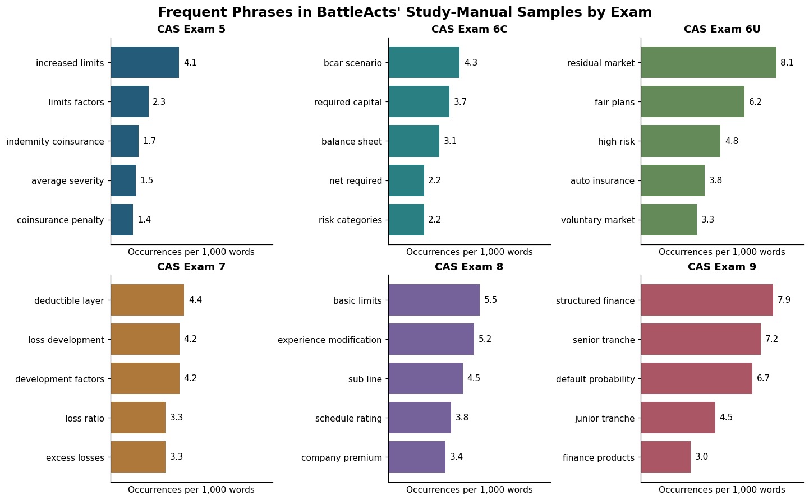
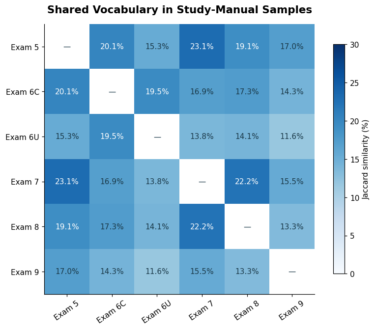
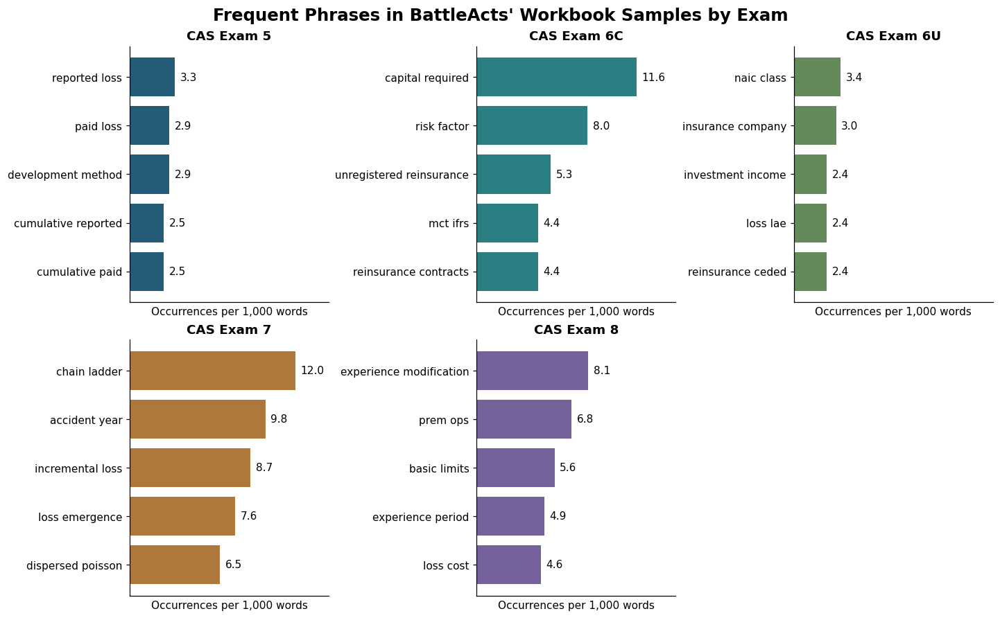

# Actuarial Exam Preparation Market Intelligence: BattleActs

**Maxine Hakimi-Bulson** | Python · Web scraping · Text mining · Data visualization

## Overview

An end-to-end analysis of publicly available BattleActs study materials for CAS Exams 5, 6C, 6U, 7, 8 and 9, collected October 19, 2026 with written permission for one-time educational collection and sharing of code, data and analysis.

## Key findings

- Six courses, nine unique PDF samples and six Excel workbooks.
- Five USD-priced courses average $900; Exam 6C is CAD 1,000.
- All courses advertise seven months of access and a conditional six-month extension.
- Manual samples contain 2,090–6,530 cleaned words.
- Exams 5 and 7 have the highest manual vocabulary overlap (23.1% Jaccard similarity).
- 87 of 95 workbook worksheets were eligible for text analysis.

## Notebooks

1. [Product data collection](01_product_data_collection.ipynb): Selenium navigation, structured extraction, PDF and Excel parsing, validation and descriptive summaries.
2. [Text analysis](02_text_analysis.ipynb): text preprocessing, normalized bigram frequencies and vocabulary similarity.

## Visual findings

## Reproducing the analysis

Install dependencies with `pip install -r requirements.txt`. Run both notebooks from the repository root. The included CSVs contain product information and reconstructed file-level sample inventories (counts and source metadata, not full sample text). Notebook 1 runs offline by default. Notebook 2 requires the original sample files in `sample_files/`, with PDF and Excel subdirectories organized by exam. These documents are not redistributed here. Obtain authorized copies before running Notebook 2. Both notebooks were executed successfully using the saved collection and original local documents. Live scraping was not tested or repeated. Generated text exports should remain local.

## Scope

Results describe the collected public excerpts, not full course coverage, exam difficulty, teaching quality or student outcomes. Prices reflect the collection date; currencies are not pooled.

Source: [BattleActs](https://battleactsmain.ca/v2/home).
